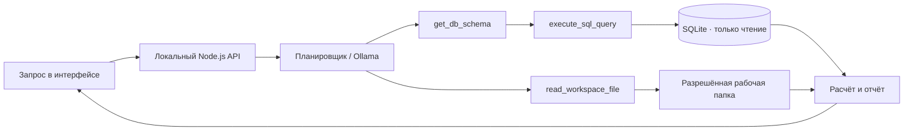

# Orbit · Business Operating AI

**Один рабочий центр для аналитики и повседневных задач малого бизнеса.**

Команда **SanaX** · Хакатон Жамбыл Хаб · **AI for SME & Local Business**

[Открыть публичное демо](https://orbit-business-os-demo.harrypotter123554.chatgpt.site/) · [Локальный агент: руководство](docs/LOCAL_AGENT.md) · [Архитектура](ARCHITECTURE.md) · [Проверка MVP](VERIFICATION.md)

## Для кого и зачем

Предпринимателю приходится собирать выручку и расходы из таблиц, просматривать кандидатов и готовить ответы клиентам в разных инструментах. Orbit объединяет эти задачи в одном интерфейсе: пользователь подключает локальные данные и задаёт вопрос обычным языком, а агент показывает вызванные инструменты, расчёты и результат.

Основной сценарий: **подключить SQLite или финансовый файл → спросить о маржинальности → увидеть SQL, отчёт и график → подготовить следующий шаг для бизнеса**.

## Два способа познакомиться с продуктом

| Версия | Где открыть | Что выполняется |
|---|---|---|
| Публичное веб-демо v1 | [Сайт Orbit](https://orbit-business-os-demo.harrypotter123554.chatgpt.site/) | Интерфейс и браузерная демонстрационная логика на тестовых данных. Без доступа к диску посетителя |
| Локальный агент v2 | Код в корне этого репозитория | Настоящее чтение SQLite и файлов рабочей папки, SELECT, поток событий выполнения и расчёты по полученным данным |

## Быстрый запуск локального агента

Нужны **Node.js 20.3+**, npm и **Python 3.10+** (`python3` в PATH). Внешних npm/pip-зависимостей нет.

```bash
git clone https://github.com/shadix23/orbit-business-agent.git
cd orbit-business-agent
npm run init:sample
npm start
```

Откройте **http://localhost:3000**. `init:sample` создаёт вымышленные данные в `workspace/`: SQLite, CSV, JSON, XLSX, кандидатов и диалоги. Существующие файлы не перезаписываются. Рабочая папка и секреты не входят в репозиторий.

Для своей компании откройте **Интеграции → Настроить подключение**, выберите разрешённую рабочую папку и SQLite-файл либо финансовую таблицу. Подробные форматы и переменные окружения — в [руководстве](docs/LOCAL_AGENT.md).

## Что уже работает

- **Аналитика:** реальные SQLite SELECT и чтение CSV / JSON / XLSX, выручка, прибыль, маржинальность, периоды и графики.
- **Агент:** инспекция схемы, генерация SQL по найденным полям, выполнение инструментов, потоковый журнал и остановка задачи.
- **HR:** чтение структурированных кандидатов из локального источника и прозрачный скоринг навыков и опыта. Решение принимает человек.
- **Коммуникации:** просмотр локальных диалогов и подготовка черновиков ответов.
- **SMM:** контент-план из финансовой аналитики и черновики публикаций.
- **Интерфейс:** светлая и графитовая тёмная темы, Comfortaa, орбитальная анимация, адаптивная вёрстка и поддержка reduced motion.

## Как устроен агент



**Без модели:** встроенный детерминированный планировщик обрабатывает поддерживаемые финансовые вопросы, SQL, файлы и HR. Он вызывает настоящие инструменты, но не является универсальной LLM.

**С локальной моделью:** реализован адаптер Ollama с tool calling, до 8 итераций и 12 вызовов инструментов. Модель устанавливается отдельно. Адаптер проверен тестом с подменой модельного ответа; живая Ollama-модель в проверке MVP не запускалась.

Технологии: HTML, CSS, JavaScript ES Modules, Node.js HTTP API, Python standard library, SQLite. Передача журнала — NDJSON. Внешний шрифт Comfortaa загружается из Google Fonts; без сети используется системный fallback.

## Проверить за минуту

1. Запустите локальную версию и откройте «Агент».
2. Отправьте: **«Посчитай маржинальность за последний месяц»**.
3. Раскройте журнал: видны схема, реальный SELECT и результат.
4. На подготовленных **тестовых данных** за сентябрь 2026: выручка **7 700 400 ₸**, прибыль **3 187 967 ₸**, маржа **41,4%**.
5. Откройте «Аналитика → Рабочая папка» и прочитайте `finance/sales.xlsx`.

```bash
npm test
npm run check
```

Автоматические тесты проверяют инструменты, чтение файлов, поток событий, расчёты, отмену и запреты на запись. Подробности — в [VERIFICATION.md](VERIFICATION.md).

## Границы MVP

SQLite открыт только для чтения; агент не меняет исходные данные. Файлы доступны только внутри выбранной рабочей папки. Сервер слушает loopback и предназначен для локального запуска. Лимиты: до 5 МБ на файл и до 10 000 строк табличного источника.

PostgreSQL / MySQL, реальные WhatsApp и Instagram API, отправка сообщений и публикация постов пока не реализованы. Финансовые результаты и кандидаты в примере вымышленные. Пилот с реальным бизнесом и измерение экономического эффекта — следующие шаги, а не подтверждённые результаты.

## Структура

```text
dist/                 интерфейс и клиент API
local/                цикл агента, инструменты, SQLite и файловая граница
scripts/              генерация тестовой базы и файлов
tests/                автоматические проверки
docs/LOCAL_AGENT.md   форматы данных, настройка, API и ограничения
server.mjs            локальный HTTP-сервер
web-demo/             исходники публичного демонстрационного сайта v1
```

Чтобы отдельно запустить веб-демо: `cd web-demo && npm start` (остановите другой сервер на порту 3000 либо задайте другой `PORT`). Оно демонстрирует продукт и не заменяет локальный агент.

## Следующий этап

Пилот с предпринимателями Тараза и Жамбылской области: проверить финансовый сценарий на разрешённой reporting-копии данных, измерить время подготовки отчёта и доработать интеграции по результатам тестирования.
